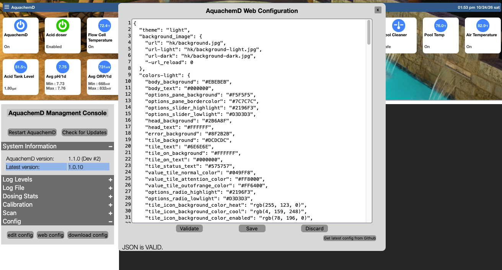

  

<h1 align="center">AquachemD</h1>

<b>Open-source, automated pool water chemistry — pH, ORP, and dosing, done right.</b>

---

# AquachemD Web UI — `webconfig.json` Reference

`webconfig.json` controls the look and behaviour of the built-in web dashboard: theme colours, the background image, and per-device display rules (icons, thresholds, units, custom labels).

## Editing

You can edit the `web config`, by opening `AquachemD's management console`, expanding the `config` menu on the left (bottom), then selecting `web config`.  Or by editing `/var/www/aquachemd/config.json`.
 

---

## The disabled-key convention

Keys prefixed with `__` are present in the default config but **inactive** — they show you what's available without turning it on. To enable one, remove the `__` prefix so the key name matches exactly what's shown below (e.g. `__on_icon` → `on_icon`).

The `background_image` block uses a **different** prefix (`-`) for the same purpose, and it's easy to miss: as shipped, `-url`, `-url-light`, `-url-dark`, and `-url_reload` are inert, because the code looks for `url`, `url-light`, `url-dark`, and `url_reload` — without the dash. Remove the leading `-` from all four keys to actually set a custom background.

---

## `theme`

A string: `"light"`, `"dark"`, or empty to follow the browser/OS preference.

## `background_image`

| Key (once the `-` is removed) | Description |
| :--- | :--- |
| `url` | Background image path, used as the fallback if a theme-specific one isn't set. |
| `url-light` / `url-dark` | Theme-specific background image path. |
| `url_reload` | Seconds between automatic reloads of the image (e.g. for a live camera snapshot). `0` disables reloading. |

## `colors-light` / `colors-dark`

Two parallel sets of CSS colour variables, one applied per theme. The names are mostly self-describing (`body_background`, `head_text`, `tile_on_background`, and so on) — set any of them to a hex value to override that element's colour for that theme. `colors-dark` has two entries with no `colors-light` equivalent (`csinputcell_background`, `options_button_background`) — those simply fall back to a built-in default under the light theme.

---

## `devices`

Each key is a device ID (matching the ID from `/api/devices`). All fields are optional — an empty `{}` or omitting a device entirely just uses the built-in defaults.

| Key | Description |
| :--- | :--- |
| `display` | `true`/`false` — whether this device's tile shows at all. |
| `on_text` / `off_text` | Replaces the default "ON"/"OFF" label with custom text — e.g. a pH sensor showing `"Sampling"` instead of "ON", since "on" doesn't really describe what a sensor is doing. |
| `precision` | Number of decimal places shown for a numeric reading (applied via `.toFixed()`, so `0` rounds to a whole number, `2` always shows two decimals even for a whole-number reading). |
| `uom` | Overrides the displayed unit string for this device. |
| `add_uom2label` | Appends the unit to the device's label text rather than showing it elsewhere in the tile. |
| `on_icon` / `off_icon` | Custom SVG icon paths shown depending on device state. **Both must be set together** — the code only applies custom icons if both are present. |
| `thresholds.outofrange.min` / `.max` | Value bounds that trigger the "out of range" visual treatment. Inclusive — a reading exactly at `min` or `max` counts as out of range. |
| `thresholds.outofrange.mintext` / `.maxtext` | Custom label shown when the `min`/`max` bound specifically is what was breached (e.g. `"To Cold"` / `"To Hot"` for temperature, `"Clean Filter"` for a high-pressure reading suggesting the filter needs attention). Falls back to a generic "Out of range" if not set. |
| `thresholds.attention.min` / `.max` / `.mintext` / `.maxtext` | Same shape as `outofrange`, but for a milder warning tier — a narrower band inside the full acceptable range that flags "worth watching" rather than "wrong." |

### Multi-value sensors (dotted sub-IDs)

A sensor that reports more than one derived value from a single reading — the default config's `EC_1`/`EC_1.1`/`EC_1.2`/`EC_1.3` is the example — publishes its secondary values as separate device entries using `<base_id>.<n>` as the key. Each sub-entry gets its own `display`/`precision`/`on_text`/etc., exactly like a standalone device. For a conductivity probe, this is the pattern you'd expect EC, TDS, Salinity, and Specific Gravity to use if they're all derived from the one EZO EC circuit reading — worth keeping this convention in mind if conductivity support lands, since the web UI is already set up to handle one physical sensor publishing several related readings this way.

### A trick worth knowing: disabling one side of a threshold

`TNK_1`'s config sets `outofrange.max: 101` on a value that's a 0–100% reading — since the value can never actually reach 101, the max side of that threshold can never trigger, leaving only the `min` bound (empty tank warning) active. This is the pattern to use any time you only care about one direction of a threshold: set the other bound to something outside the value's real range rather than omitting it.

---

## `slider_range`

Configures the manual run-time slider shown when controlling a doser/switch from the dashboard.

| Key | Description |
| :--- | :--- |
| `timer_slider_min` | Minimum selectable value. Defaults to `0` if omitted. |
| `timer_slider_max` | Default maximum selectable value. A device's own configured max runtime can override this per-device — worth testing with a specific doser if you need to confirm which one wins for your setup. |
| `timer_slider_step` | Increment per slider step. Defaults to `1` if omitted. |

## `tile_settings`

Global display toggles, applied across all matching devices rather than per-device.

| Key | Description |
| :--- | :--- |
| `orp_runtime_in_minutes` | Shows the run-time slider/value in minutes rather than seconds, for any device whose attributes include `orp_pump`. |
| `h2o_runtime_in_minutes` | Same, for devices tagged `h2o_pump`. |
| `switch_runtime_in_minutes` | Same, for devices tagged `gpio_output`. |
| `display_temp_in_f` | Converts any `°C`-labelled reading to Fahrenheit for display only — the underlying stored/transmitted value stays in °C regardless of this setting. |
| `disable_off_icon_background` | Not present in the default config, but a real, working option — turns off the circular background normally drawn behind a tile's icon when the device is off. |

---
